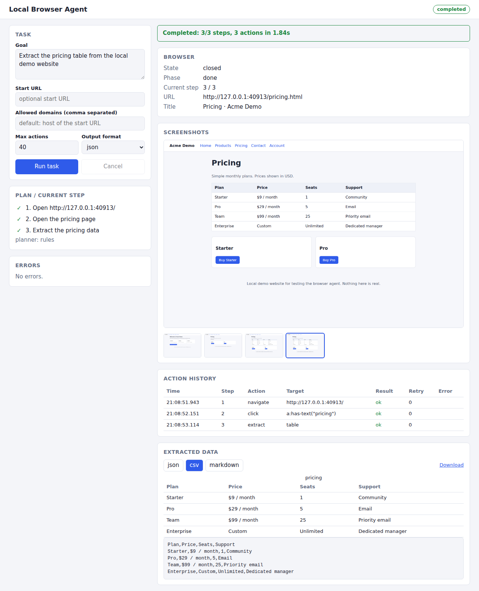

# Local Browser Agent

An agent that carries out structured browser tasks in a **local Chromium** (via Playwright) through a **controlled action system**. You give it a goal such as

> Open a website, find the pricing page, extract the pricing information, and save it as structured JSON.

and it plans the steps, performs them, checks that each one actually worked, recovers from common failures, and records everything it did. Nothing leaves your machine: there is no cloud AI requirement and no paid API. Where a model is useful it is an optional **local** model (Ollama on loopback); the default planner is deterministic.

```
browser-agent run "Extract the pricing table from the local demo website"
```



## Architecture

```
Goal
 ↓
Planner ──────────────► validated Plan (list of steps: Action + Expectation)
 ↓
┌──────────────────────── for each step ─────────────────────────┐
│ Observe   URL, title, visible text, interactive elements       │
│ Guard     resolve target element → safety policy → confirm?    │
│ Action    Playwright browser controller                        │
│ Verify    implicit check for the action + the step's           │
│           expectation (URL/title/text/element)                 │
│ Recover   retry, wait, dismiss overlay, re-observe and pick    │
│           another element, follow the link target directly     │
└────────────────────────────────────────────────────────────────┘
 ↓
Complete   (completed | failed | blocked | aborted) + logs, screenshots, extracted data
```

| Module | Role |
| --- | --- |
| `actions.py` | Pydantic schema for `Action`, `Expectation`, `PlanStep`, `Plan`. Everything a planner produces is validated here. |
| `planner.py` | `RulesPlanner` (deterministic, no model), `OllamaPlanner` (local model, validated, falls back to rules), `StaticPlanner`. |
| `controller.py` | Playwright wrapper: navigate, click, type, select, scroll, extract, screenshot, wait, back/forward/reload. Aborts requests to disallowed domains. |
| `observer.py` | In-page collection of visible elements (with selectors that avoid auto-generated ids), tables, headings, overlays. |
| `verifier.py` | Checks that an action had its effect. |
| `recovery.py` | Chooses a recovery strategy from the failure kind. |
| `safety.py` | Domain rules, hard blocks, confirmation, limits. |
| `extraction.py` | Table/list/links/text extraction and JSON/CSV/Markdown rendering. |
| `logs.py` | Structured execution log (JSONL). |
| `agent.py` | The loop above. |
| `cli.py`, `server.py`, `frontend/` | CLI, dashboard API, dashboard UI. |
| `demo_site/` | Local test website (navigation, forms, tables, dynamic and intentionally changing elements). |

## Safety model

The agent drives a real browser, so it is restrictive by default.

* **Domains.** Only the start URL's host is allowed unless you pass `--allow-domain`. `--block-domain` always wins. Non-`http(s)` schemes (`file:`, `javascript:` …) are refused. The policy is enforced before navigation **and** on every network request the page makes (requests to other domains are aborted), and the page the browser ends up on is re-checked.
* **Hard blocks (never performed, cannot be confirmed away, not even with `--yes`):**
  * financial actions: clicking buy / pay / checkout / place order / donate / add to cart …
  * account deletion: delete/close/deactivate account, `…/delete-account` links
  * credential handling: typing into or extracting from password, card-number, CVV, OTP, SSN, secret/token fields
* **Confirmation.** Submitting a form (submit buttons, pressing Enter in a form) needs explicit approval: an interactive prompt on the CLI, a modal in the dashboard, or a `confirmer` callback in the Python API. With no way to ask (non-interactive shell, no `--yes`) the answer is *no*. `--yes` approves confirmable actions only.
* **Limits.** Maximum actions (retries and recovery steps count), per-action timeout, whole-task timeout (time spent waiting for a person does not count).
* **Containment.** Fresh browser context per run, downloads disabled, service workers blocked, JavaScript dialogs dismissed and logged, pop-up windows closed.
* **Honesty.** Steps are only "done" when verification passed. If a step cannot be completed the run fails and reports why; the agent never fills in data it did not extract. A goal that names no site is a planning error – it does not guess a site.
* **Dashboard API** binds to `127.0.0.1` and refuses cross-origin POSTs, so a web page you visit cannot start tasks.

These are guard rails, not a sandbox. See [Limitations](#limitations).

## Installation

Requires Python 3.10+ (developed and tested on 3.11) and, for the dashboard build only, Node 18+.

```bash
git clone <this repository> && cd <repository>
python -m venv .venv && source .venv/bin/activate
pip install -e ".[dev]"
```

### Playwright setup

```bash
playwright install chromium          # downloads the browser Playwright expects
```

If you already have a Chromium build, point the agent at it instead:

```bash
export BROWSER_AGENT_CHROMIUM=/path/to/chrome
```

A Playwright release expects a specific Chromium revision. If launching fails with "Executable doesn't exist", either run `playwright install chromium` or install the Playwright version whose revision you have.

### Dashboard build (optional)

```bash
cd frontend && npm install && npm run build   # outputs to src/browser_agent/ui_dist
```

## Running the local demo

```bash
browser-agent demo                 # serves the demo site on http://127.0.0.1:8765/
browser-agent serve                # dashboard on http://127.0.0.1:8000/ (also starts the demo site)
browser-agent run "Extract the pricing table from the local demo website"
```

Any goal that mentions "the local demo website" starts the demo site automatically for the duration of the run.

The demo site has: navigation, a pricing table that loads asynchronously, a products table with a filter and a "Load more" button, a contact form, an account page (password field, *Delete account*) and a checkout page (*Pay now*) that the agent must refuse to use, and a page with late-appearing elements. Nav links get **new ids and classes on every load**; `?variant=b` renames the Pricing link to "Plans"; `?promo=1` shows a blocking modal; `?seed=N` makes the random ids repeatable.

## CLI

```
browser-agent run GOAL [--url URL] [--allow-domain D]... [--block-domain D]...
                       [--max-actions N] [--timeout SECONDS] [--action-timeout MS] [--max-retries N]
                       [--format json|csv|markdown] [--output FILE] [--runs-dir DIR]
                       [--screenshots steps|final|none] [--headed] [--yes | --no-confirm] [--json]
                       [--planner rules|ollama --model NAME --ollama-url URL]
browser-agent plan  GOAL [--url URL]      # print the plan, no browser
browser-agent demo  [--port 8765]
browser-agent serve [--host 127.0.0.1] [--port 8000] [--demo-port 8765]
browser-agent test  [--only NAME] [--headed] [--pytest]
```

Examples:

```bash
browser-agent run "Extract the products table" --url http://127.0.0.1:8765/ --format csv -o products.csv
browser-agent run 'On the local demo site open the contact page and fill the form with name=Ada, email=ada@example.com, message="Hello"'
```

Exit codes: `0` completed, `1` failed or aborted, `3` blocked by the safety policy.

`browser-agent test` runs the built-in end-to-end scenarios (`selftest.py`) in a real browser against the demo site – no pytest needed. `browser-agent test --pytest` runs the full pytest suite from a checkout.

### What the rules planner understands

The default planner is deliberately simple and predictable. It recognises: a start URL (or "the local demo website"); "find/open/go to the *X* page" (or an *X* table/list in an "extract …" phrase); `select V from the F dropdown`; "load more"; form fields as `name=…, email=…, message="…"`; extracting a table, list, links or text; scrolling to the bottom; taking a screenshot. Goals outside those shapes produce a short plan (often just "open the page") and a note saying so.

### Optional local model planner

```bash
ollama serve &   # any model you have pulled
browser-agent run "..." --url http://127.0.0.1:8765/ --planner ollama --model <name>
```

The model's JSON is validated against the action schema; invalid output or an unreachable model falls back to the rules planner and says so in the plan notes. The endpoint must be loopback. The Ollama path is covered by tests against a stub server; it has **not** been exercised against a real model.

## Python API

```python
from browser_agent import Agent, AgentConfig, SafetyPolicy, approve_all
from browser_agent.demo_site import DemoServer

with DemoServer() as demo:                       # or any URL you are allowed to automate
    agent = Agent(AgentConfig(
        policy=SafetyPolicy(allowed_domains=["127.0.0.1"], max_actions=30),
        confirmer=lambda req: False,             # decide on sensitive actions; approve_all for yes
        demo_url=demo.url,
        runs_dir="runs",
    ))
    result = agent.run("Extract the pricing table from the local demo website")

print(result.status)          # completed | failed | blocked | aborted
print(result.render("csv"))   # also "json", "markdown"
print(result.extracted["pricing"][0])
```

`RunResult` also has `plan`, `log`, `screenshots`, `error`, `steps_completed`, `actions_used`, `run_dir`. Pass `on_event=callable` to `AgentConfig` to stream events (`status`, `plan`, `step`, `log`, `screenshot`, `extracted`, `confirm_request`). Use `StaticPlanner(plan)` to run a hand-written plan, and `BrowserController` directly for raw browser operations.

## Action schema

Every action is a JSON object validated by `Action` (unknown fields are rejected; every action needs a non-empty `reason`):

```json
{ "type": "click", "selector": "a:has-text(\"Pricing\")", "fallback_text": "Pricing", "reason": "open the pricing page" }
```

| `type` | required | optional |
| --- | --- | --- |
| `navigate` | `url` (absolute http/https) | |
| `click` | `selector` | `fallback_text` |
| `type` | `selector`, `text` | `press_enter`, `fallback_text` |
| `select` | `selector`, `value` (value or label) | `fallback_text` |
| `scroll` | | `direction` (`down` `up` `top` `bottom`), `amount` (px) |
| `extract` | `selector` | `mode` (`text` `table` `list` `links`), `name` |
| `screenshot` | | `name`, `full_page` |
| `wait` | `ms` or `selector` | |

Selectors are Playwright selectors (CSS, `text=`, `:has-text()` …). `fallback_text` is the human label of the target and is what recovery searches for if the selector goes stale.

A plan step pairs an action with an **expectation** checked after it runs:

```json
{ "id": 2, "description": "Open the pricing page",
  "action": { "type": "click", "selector": "a:has-text(\"pricing\")", "fallback_text": "pricing", "reason": "…" },
  "expect": { "url_contains": "pricing", "title_contains": "pricing", "mode": "any" } }
```

`expect` fields: `url_contains`, `title_contains`, `text_contains`, `selector_visible`, `mode` (`all`/`any`). In addition every action type has an implicit check (typed value present, option selected, extraction non-empty, screenshot file written, scroll position changed). `browser-agent plan GOAL` prints a full plan.

### Recovery

| Failure | Response |
| --- | --- |
| Missing / stale selector | wait for dynamic content → re-observe and pick the closest element (by label, id, name, href) → keep waiting until retries are used up |
| Click intercepted (modal, banner) | dismiss the overlay (never anything sensitive) and retry |
| Timeout | retry with a longer timeout (capped at 4×), then reload |
| Verification failed | wait and re-verify → go back if the click landed elsewhere → navigate straight to a matching link target or use another element |
| Navigation error | wait and retry; domain-policy refusals are never retried |
| Safety violation, limit, cancellation | no recovery |

## Logs

Each run writes `runs/<timestamp>-<id>/` with `log.jsonl`, `result.json`, `extracted.<fmt>` and `screenshots/`. One log line per action attempt:

```json
{"timestamp": "2026-09-30T21:06:31.235+00:00", "step": 2, "action": "click", "target": "a:has-text(\"pricing\")",
 "result": "ok", "error": null, "retry_count": 0, "duration_ms": 160, "verified": true,
 "detail": "clicked …; navigated to …/pricing.html; ok: url contains 'pricing'", "screenshot": "…/002-step2-click.png"}
```

`result` is `ok`, `failed`, `retry` (failed, recovery attempted), `blocked`, `skipped` (optional step) or `info` (confirmations, recovery notes). Recovery operations appear as `recovery:wait`, `recovery:dismiss_overlay`, …

## Testing

```bash
pytest                      # 141 tests; browser tests launch real Chromium
browser-agent test          # built-in end-to-end scenarios
cd frontend && npm run build   # type-check + production build
```

Coverage: action validation, planner (rules + local-model stub), domain restrictions, safety assessment, extraction formats, log format, browser controller (every operation, hidden-row handling, blocked requests, dialogs, pop-ups), retry/timeout/limit/cancel logic (with a scripted controller), end-to-end scenarios against the demo site (extraction, stale selectors, renamed links, blocking overlay, dynamic content, blocked purchase / deletion / password, confirmation, domain blocks, action limit, honest failure), the CLI as a subprocess, the dashboard API, and the dashboard UI driven by Playwright. Browser tests are marked `browser`; run only unit tests with `pytest -m "not browser"`.

## Limitations

* Guard rails, not a sandbox: safety decisions rely on element text/attributes, so an unlabeled or deceptively labeled button can slip past the hard-block patterns, and there is a small gap between checking an element and clicking it on a page that mutates. Do not point the agent at sites or accounts you would not trust a script with, and keep the allow-list tight.
* Chromium only. Single tab: pop-ups are closed. No file uploads/downloads, no iframes/shadow-DOM-aware observation, no CAPTCHA or login flows (credentials are deliberately out of scope).
* The rules planner handles a bounded set of goal shapes. Free-form goals need the optional local model planner, whose quality depends on the model; it is validated but not guaranteed to be good.
* Element matching during recovery is lexical (shared words), not semantic.
* Extraction returns text as displayed; values are not type-converted.
* The dashboard runs one task at a time and polls every 400 ms.
* Verified only on Linux with Python 3.11 and Chromium 141.

## Roadmap

* Multi-tab support and iframe-aware observation
* Session/profile reuse for sites where the user has explicitly logged in
* Smarter page-type detection and schema-driven extraction (typed columns)
* Server-sent events for the dashboard; run history browser
* More local-model backends and plan self-critique
* Additional browsers (Firefox, WebKit)

## License

MIT – see [LICENSE](LICENSE).
